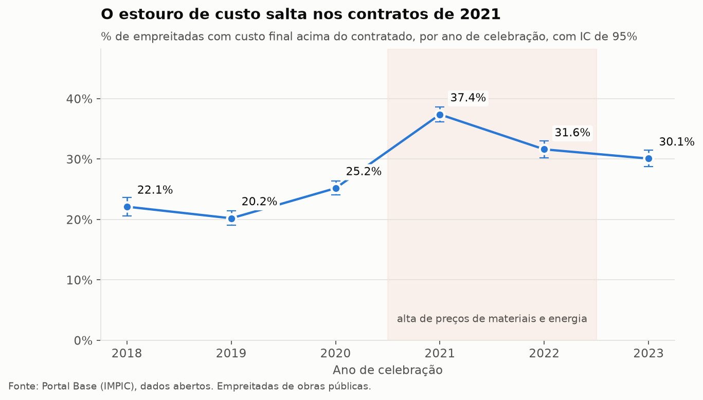
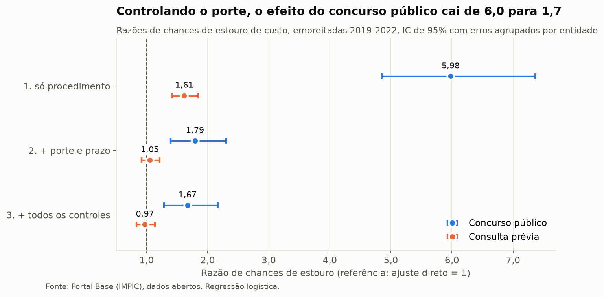
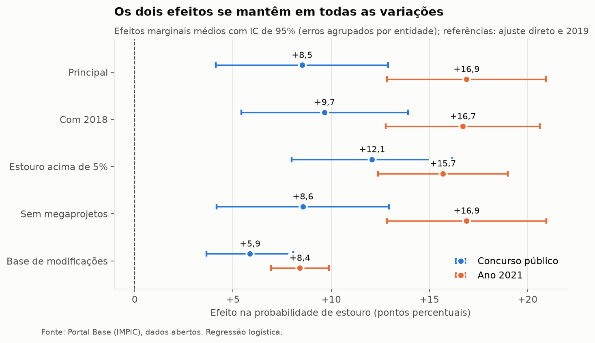

# Radar de Desvios de Custo e Prazo em Obras Públicas

**Quanto as empreitadas de obras públicas em Portugal se afastam do preço e do prazo contratados, e o que explica esses desvios.**

[**Abrir o painel interativo →**](https://radar-obras-publicas.streamlit.app)

> **In English.** An analysis of ~48,000 Portuguese public works contracts signed in 2019–2022 (20,379 with a recorded final cost) from the open-data Portal Base, using Earned Value Management–style indices, SQL, statistics and an interactive dashboard. 29% of contracts end over budget; the share jumped from 20% to 37% for contracts signed in 2021, during the construction-cost surge. Contract size is the strongest predictor of overruns, but open tenders (*concurso público*) keep an effect of their own (+8.5 p.p.) after controlling for size, year, type of work, region and number of bidders.

---

## Principais resultados

Empreitadas de obras públicas celebradas de 2019 a 2022, com custo final registado (20.379 contratos):

- **29,1% das obras terminam acima do preço contratado.** 56,6% terminam exatamente no preço. Quando há estouro, o estouro mediano é de 6,5%.
- **O estouro salta com a alta de preços de 2021–2022.** A percentagem de obras com estouro passa de 20,2% (contratos de 2019) para 37,4% (2021) e não volta ao patamar anterior. Mantendo constantes o porte, o procedimento, o tipo de obra, a região e a concorrência, um contrato de 2021 tem **+16,9 pontos percentuais** de probabilidade de estouro face a um de 2019.

  

- **O porte é o fator mais forte.** O estouro vai de 21,8% nas obras até 150 mil euros a 82,5% nas obras acima de 5 milhões. Cada vez que o preço contratual é dez vezes maior, a probabilidade de estouro sobe 16,7 pontos percentuais.
- **O concurso público estoura mais, mesmo entre obras do mesmo tamanho.** Sem controles, as chances de estouro no concurso público são 6 vezes as do ajuste direto. Controlando o porte e os demais fatores, a razão cai para 1,7, mas não desaparece: **+8,5 pontos percentuais** (IC 95%: 4,1 a 12,9). Já a consulta prévia não tem efeito próprio quando se controla o porte.

  

- **O número de concorrentes não explica o efeito do concurso.** A hipótese da "maldição do vencedor" (mais concorrência, preços mais agressivos, mais estouro) não é apoiada pelos dados.
- **Os trabalhos complementares são a principal causa das modificações:** cerca de 72% das obras modificadas, um sinal de projetos de execução pouco rigorosos.
- **Os resultados são robustos.** Os efeitos do concurso público e de 2021 continuam positivos e significativos em cinco variações do modelo, incluindo uma medida de custo independente, baseada nas modificações contratuais, que não depende de o fecho do contrato ter sido registado.

  

- **Os dados abertos não permitem medir o atraso com precisão.** Pelas duas aproximações disponíveis, entre 9% e 90% das obras de 2022 excederam o prazo. A faixa larga é, em si, um achado sobre os limites da transparência do Portal Base.

## O que este projeto demonstra

| Competência | Onde |
| --- | --- |
| Inferência estatística: intervalos de confiança (Wilson), qui-quadrado e V de Cramér, Mann-Whitney, correlação de Spearman | [`notebooks/04_descritiva.ipynb`](notebooks/04_descritiva.ipynb), [`05_testes_regressao.ipynb`](notebooks/05_testes_regressao.ipynb) |
| Modelagem: regressão logística com erros-padrão agrupados, efeitos marginais médios, modelos em camadas para isolar fatores de confusão | [`notebooks/05_testes_regressao.ipynb`](notebooks/05_testes_regressao.ipynb) |
| Validação: testes de robustez, triangulação entre medidas independentes, modelo de viés de seleção | [`notebooks/06_robustez.ipynb`](notebooks/06_robustez.ipynb) |
| Qualidade de dados: diagnóstico de completude e de conteúdo, censura, regras de limpeza documentadas (D1 a D13) | [`notebooks/01_completude.ipynb`](notebooks/01_completude.ipynb), [`src/transform.py`](src/transform.py) |
| Engenharia de dados: pipeline reprodutível em Python (xlsx → parquet → dados processados), deflação de séries | [`src/`](src/) |
| SQL analítico e modelagem dimensional (esquema em estrela, JOIN, CTEs, funções de janela) | [`sql/`](sql/) |
| Visualização e painel interativo publicado | [`app/app.py`](app/app.py), [painel](https://radar-obras-publicas.streamlit.app) |
| Conhecimento de domínio: índices de desempenho de projetos (Gestão do Valor Agregado) adaptados a contratos públicos | [Roteiro, seções 3 e 4](docs/) |

## Dados

| Fonte | Conteúdo | Arquivos |
| --- | --- | --- |
| [IMPIC – Portal Base: contratos](https://dados.gov.pt/pt/datasets/66d72d488ca4b7cb2de28712/) | Todos os contratos públicos registados, 2012–2026 | `contratos<ANO>.xlsx` |
| [IMPIC – Portal Base: modificações contratuais](https://dados.gov.pt/pt/datasets/668d65dbcb1b953e80198435/) | Alterações de preço e prazo, com o fundamento | `modcontra<ANO>.xlsx` (2018–2022) |
| [INE – índice de custo de construção de habitação nova](https://www.ine.pt/xurl/indx/0011748/PT) | Índice mensal, base 2021 = 100 | `ine_icchn.xls` |

Os dados brutos não estão no repositório (são grandes e públicos). Para reproduzir a análise, baixe-os para `data/raw/` com os nomes acima.

## Método, em resumo

**Unidade de análise:** contrato de empreitada de obras públicas. **Janela principal:** contratos celebrados de 2019 a 2022. Antes de 2018 o fecho dos contratos quase não era registado; a partir de 2023 muitas obras ainda não tinham terminado.

**Índices, inspirados na Gestão do Valor Agregado:**

- **Custo (CPIc)** = preço contratual ÷ preço total efetivo. Abaixo de 1 = estouro. Só para contratos com fecho registado, terminados por cumprimento e com valores plausíveis.
- **Prazo, em intervalo:** como os dados não registam a data real de conclusão da obra, o atraso é medido entre um limite inferior (prorrogações formais de prazo) e um limite superior (tempo até o fecho do contrato no Portal, que inclui tempo administrativo).

**Modelo:** regressão logística da probabilidade de estouro em função do porte (preço deflacionado pelo índice do INE), prazo, procedimento, tipo de obra (CPV), distrito, ano de celebração e número de concorrentes, com erros-padrão agrupados por entidade adjudicante. Resultados apresentados como efeitos marginais médios, em pontos percentuais.

Todas as decisões de método, os diagnósticos e os resultados intermédios estão registados no roteiro do projeto, em [`docs/`](docs/).

## Limitações

- Só cerca de 45% das empreitadas têm o fecho registado. Há seleção moderada (o registo melhora ao longo dos anos e é um pouco menor nos concursos públicos), mas a medida baseada nas modificações, que não depende do fecho, confirma os resultados principais.
- A data de fecho no Portal inclui tempo administrativo depois do fim da obra, o que exagera o atraso medido.
- Os dados são declarados pelas próprias entidades adjudicantes, sem auditoria campo a campo; erros evidentes de registo foram excluídos por regras documentadas.
- A regressão mostra associação, não causalidade.
- O projeto mede o crescimento do custo depois da assinatura do contrato, e não a subestimação na fase de decisão.

## Estrutura do repositório

```
├── app/                   painel Streamlit (app.py, dados do painel, dependências)
├── data/                  dados brutos, intermédios e processados (não versionados)
├── docs/                  roteiro do projeto: pergunta, referencial, método e diários de cada fase
├── notebooks/
│   ├── 01_completude      diagnóstico da qualidade dos dados (Fase 0)
│   ├── 02_checagens_fase1 validação do pipeline
│   ├── 03_sql             consultas SQL
│   ├── 04_descritiva      estatística descritiva e gráficos
│   ├── 05_testes_regressao testes estatísticos e regressão logística
│   └── 06_robustez        testes de robustez e viés de seleção
├── reports/               gráficos e tabelas de resultados
├── sql/                   esquema do banco e consultas analíticas, uma por pergunta de pesquisa
└── src/                   pipeline: converter → transform → load → exportar_painel
```

## Como reproduzir

Requer Python 3.12 ou superior.

```bash
python -m venv .venv
.venv\Scripts\activate            # Windows  (Linux/macOS: source .venv/bin/activate)
pip install -r requirements.txt

# 1. Baixar os dados para data/raw/ (ver a seção Dados)
# 2. Pipeline
python src/converter.py           # xlsx -> parquet (data/interim/)
python src/transform.py           # limpeza, índices, deflação (data/processed/)
python src/load.py                # banco SQLite (data/obras.db)

# 3. Análise: rodar os notebooks 01 a 06, em ordem

# 4. Painel
python src/exportar_painel.py
streamlit run app/app.py
```

## Ferramentas

Python (pandas, statsmodels, scipy, matplotlib, Altair), SQLite, Jupyter, Streamlit, Git.

## Autora

**Alice Costa** — cientista de dados, com ênfase em estatística.
[LinkedIn](https://www.linkedin.com/in/alice-c-costa/) · [GitHub](https://github.com/alicecosta-analytics)

Os dados do Portal Base são de domínio público (IMPIC) e o índice do INE está sob licença CC BY 4.0.
